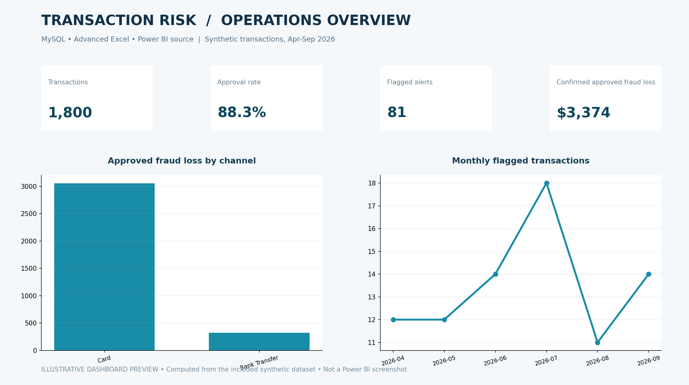

# FinTech Customer Transaction & Fraud Risk Analytics

**MySQL 8.0 · Advanced Excel · Power BI (PBIP/PBIR/TMDL + DAX)** · Synthetic FinTech portfolio project · No Python project code

## Executive brief

Design a transaction monitoring and operational-risk intelligence workflow for a digital banking business. Track payment approval, rule-triggered exceptions, confirmed simulated loss, investigation workload and channel exposure. The project builds a reproducible MySQL dataset, a formula-driven Excel workbook and a source-controlled Power BI report definition.

**The business problem:** How can an operations manager distinguish risky transaction patterns from normal payment activity, quantify approval impact, and prioritize investigative workload without treating every alert as fraud?

## Key outputs (computed from the included dataset)

| Metric | Example output |
| --- | ---: |
| Customers | 360 |
| Transactions | 1,800 |
| Submitted payment volume | $264,372.78 |
| Approval rate | 88.33% |
| Flagged transactions | 81 (4.50%) |
| Confirmed approved fraud loss | $3,374.24 |

## File navigator

| Location | Contents |
| --- | --- |
| `data/` | 4 synthetic CSV tables: customers, accounts, transactions, alerts |
| `sql/00_schema.sql` | Foreign keys, indexed MySQL schema |
| `sql/01b_seed_*.sql` | Ready-to-run INSERT scripts, no LOCAL INFILE needed |
| `sql/02_business_analysis.sql` | 8 analyst questions using joins, CTEs, CASE, conditional aggregation, HAVING, LAG, DENSE_RANK |
| `sql/03_quality_checks.sql` | Referential integrity, duplicates, outliers, alert consistency |
| `excel/` | Populated advanced Excel workbook with formulas, dashboard summaries and charts |
| `powerbi/` | Power BI developer project (`.pbip`), TMDL model, PBIR visuals, explicit DAX measures |
| `assets/` | Data-derived dashboard illustration — not an exported Power BI screenshot |
| `docs/` | BRD, data dictionary, KPI definitions, verified findings |

## Reproduce in MySQL Workbench

1. Open the SQL scripts in the order listed in `sql/01_import_order.txt`.
2. Run `sql/03_quality_checks.sql`; expect 360 customers, 360 accounts, 1800 transactions, 81 alerts, and **zero integrity errors**.
3. Run `sql/02_business_analysis.sql`; compare the first scorecard with the values above.
4. Open `excel/FinTech_Transaction_Risk_Analysis.xlsx`. The Executive_Dashboard, `IF` risk bands and `INDEX/MATCH` alerts are formula-based.
5. Optionally open `powerbi/Transaction_Risk_Intelligence.pbip` in current Power BI Desktop. See `powerbi/READ_ME_FIRST.md` for limitations.

## Data model / grain

- **Customers**: one row per synthetic customer (`customer_id`).
- **Accounts**: one per account (`account_id`), one account per customer in this sample.
- **Transactions**: one per payment attempt (`transaction_id`), including declined attempts.
- **Alerts**: one review alert per flagged transaction (`alert_id`, `transaction_id`).
- Relationships: Customers 1:1 Accounts, Accounts 1:* Transactions, Transactions 1:0..1 Alerts.

## Analytical approach

Transaction approval is calculated against *submitted* attempts; flagged rate uses submitted transactions; fraud loss includes **approved confirmed-fraud transactions only**; alerts without a confirmed fraud decision are not assumed to be fraud. See `docs/KPI_DICTIONARY.md`.

## Portfolio-ready skills demonstrated

SQL joins and CTEs; conditional aggregation and windows; analytical definitions; Excel `SUMIFS`, `COUNTIFS`, `IF`, `IFERROR`, `INDEX/MATCH`; Power BI relationships, `CALCULATE`, `FILTER`, `DIVIDE`, `RANKX`, report presentation and management-oriented recommendations.

## Repository description for GitHub

> End-to-end synthetic digital-banking transaction and fraud-risk analytics using MySQL, Advanced Excel and Power BI. Includes SQL controls, DAX KPIs, operational insights and source-controlled PBIP report assets.

**Suggested GitHub topics:** `fintech` `sql` `mysql` `power-bi` `dax` `excel` `fraud-risk` `business-analysis` `portfolio-project`

## Ethical portfolio disclosure

This is an independently prepared **synthetic analytics case study**. It does not contain real banking customer data and does not imply employment, partnership, or endorsement by Revolut or any other financial institution. Dashboard images are computed illustrative previews, not Power BI application screenshots.

## Reproducibility note

- SQL row-level data and Excel workbook are populated and checked programmatically.
- Power BI source is structured in Microsoft PBIP/PBIR/TMDL format, but **has not been opened or rendered in Power BI Desktop in this environment**. Report compatibility and screenshots must be verified before calling the Power BI dashboard operational.
- No Python notebooks or scripts are part of this repository.
